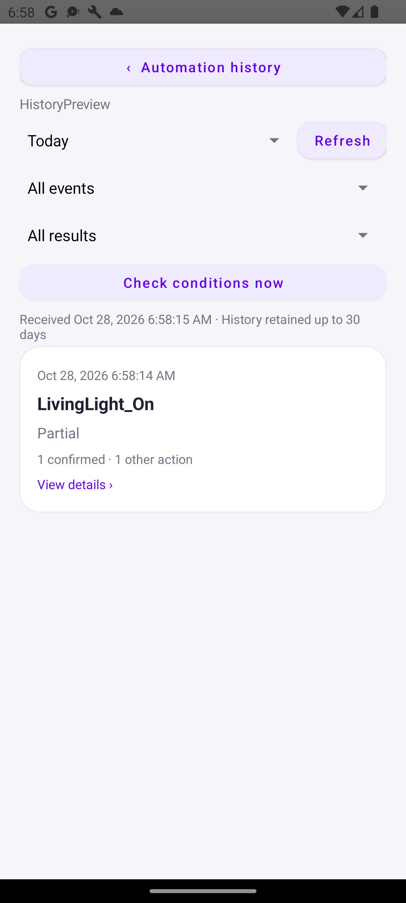
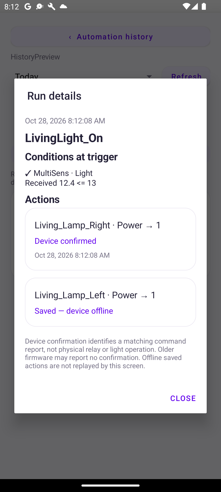
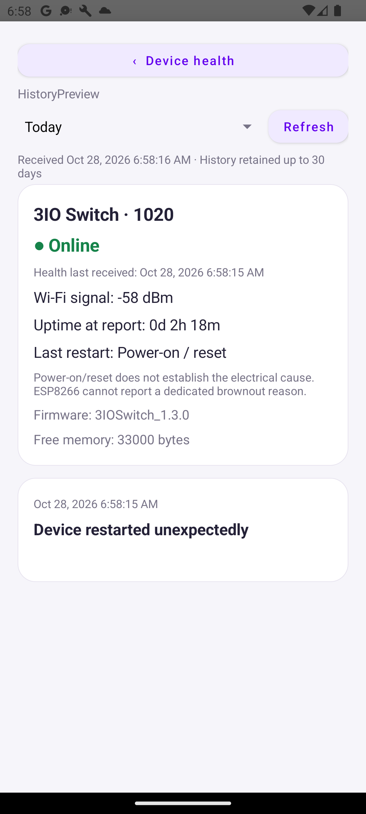
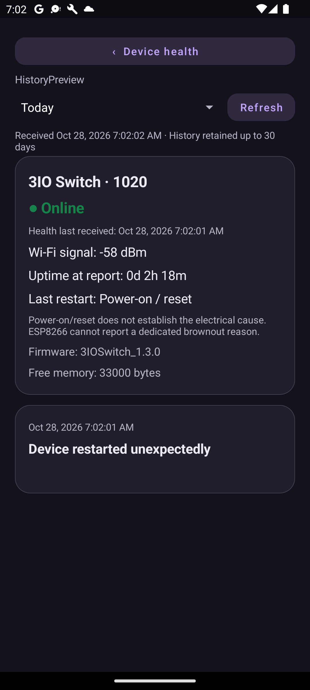
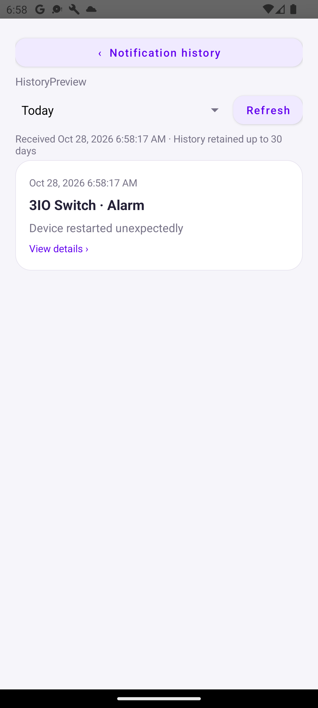

# Automation history, device health and notification history

Prepared 28 October 2026. The app and firmware are built; the existing Pi needs the manual update below. Do not use the new-hub installer for this update.

## Action result correction — 28 October 2026

The current package fixes misleading action failures: a dispatch exception means the result is unknown, since a plug may have applied a command before its response was lost. Confirmed smart-plug writes are recorded before subsequent server persistence, so a later persistence error cannot overwrite that confirmation. Install this updated Pi package using steps 1–2 again, then install the updated APK. No new device firmware or gateway protocol update is needed for this correction. Historical records marked failed cannot be reconstructed; the APK now labels them as an action error with delivery unconfirmed. The backend suite passes all 111 tests, including a simulated applied command with a lost acknowledgement; Android build and JVM tests pass.

## 1. Copy the Pi update from Windows

Open PowerShell on your laptop and run:

```powershell
scp -o HostKeyAlias=smarthubegypt "C:\Users\khale\OneDrive\Documents\ChatGPT\IOT dashboard App\Migration\Activity-Health-Update\activity-hub-update.tar.gz" khaled@192.168.178.89:~/
```

Enter the Pi user's password when prompted. The HostKeyAlias uses this laptop's existing trusted key for the Pi. A separate SSH session can remain open.

## 2. Install from your existing Pi SSH session

Run these commands on the Pi:

```bash
mkdir -p ~/activity-health-update-20261028
tar -xzf ~/activity-hub-update.tar.gz -C ~/activity-health-update-20261028
cd ~/activity-health-update-20261028
sudo bash install-activity-update.sh
```

The installer checks the existing service directory and Node runtime, validates the JavaScript, backs up the old code, briefly stops the local hub, installs seven server files, and restarts it. It does not replace credentials, device configuration, voice files or existing databases. New history tables are added automatically.

If the service fails its startup check, the script restores the previous code and restarts it. It prints the backup directory so you can keep it.

Verify:

```bash
sudo systemctl status smarthome-local --no-pager
curl http://127.0.0.1:3000/health
sudo journalctl -u smarthome-local -n 40 --no-pager
```

Wait for the app to show the home online again.

**Cloud deployment status, 28 October 2026:** successfully deployed as v65 (commit 5d34252b). Release v66 removes the temporary Node download URL override while retaining that code. The gateway now includes the history and device-health request protocol. The APK also includes a corrected read-only timeout message; read failures no longer claim that schedule changes may have been saved.

## 3. Install the APK

Install [SmartHome-activity-health-debug.apk](SmartHome-activity-health-debug.apk) over the current app. Do not uninstall first; keeping the installation preserves local settings.

## Where to find the features

### Automation history

Open **Events → history icon** (or the toolbar menu's **Automation history** entry if the icon does not fit).

- Filter Today, Last 7 days or Last 30 days, event, and result.
- Tap a run to see the condition values captured at the trigger and each action's result.
- Select an event and tap **Check conditions now** for a read-only check. It never executes the event.
- **Device confirmed** means a correlated value report, or a confirmed smart-plug command response. It does not prove physical relay/contact/light operation.
- **Sent — unconfirmed** means there was no correlated device report. Older firmware can still work with this status.
- **Saved — device offline** means the desired value was stored. Updated firmware can confirm it when it retrieves and applies that value after reconnecting.
- **Replaced by a newer command** prevents an older pending command from being incorrectly confirmed later.
- Skipped entries are recorded when a variable condition crosses into a match but the complete event does not match. The logger does not write a record on every sensor update or every clock tick. Use the read-only check for other non-triggering cases.





### Device health

Open **Devices → long-press a device → Device health**.

The page displays connection activity and, with updated SmartSnap firmware, Wi-Fi signal, uptime at the last report, free memory, firmware version, and the reported restart reason. Reports are sent after connection and every five minutes. Refresh reloads the hub's latest report; it does not increase device polling.

A reconnect with the same boot identity is not counted as another device start. ESP8266 does not identify brownouts separately, and a power-on/reset report cannot establish why power was interrupted. Unsupported devices show unavailable diagnostics rather than invented values.





### Notification history

Open **Me → Notification history** for the currently selected home, or **Devices → long-press → Notification history** for one device.

Each entry includes the timestamp, device, notification/alarm type and message. Tap it for details. The timestamp is when the hub accepted the message, not proof of phone delivery or sound playback. Messages are recorded even if the phone is closed. Existing notification settings, sounds and alarm behaviour are unchanged. No acknowledgement, snooze, incident tracking or new automatic alerts were added.



## Firmware for detailed health and confirmations

The shared SmartSnap libraries have been updated for ESP8266 and ESP32. Existing firmware still controls devices normally; it cannot report the new health fields until rebuilt/uploaded.

Ready builds:

- [3IOSwitch 1.3.0](3IOSwitch-1.3.0.bin): for the existing three-relay project.
- [MultiSens 1.3.0](MultiSens-1.3.0.bin): for the existing MultiSens project.
- [WaterHeater 1.1.0](WaterHeater-1.1.0.bin): built successfully from the current PlatformIO NodeMCU / 4 MB project with shared-library health reporting. Reports after connecting and every five minutes while connected. Not flashed to hardware. The legacy Arduino WaterHeater folder uses an older API; use the PlatformIO project for this build.
- [TempSensor_BedRoom 1.1.0](TempSensor_BedRoom-1.1.0.bin): existing ESP-01S / 1 MB project.
- [TempSensor_Living 1.1.0](TempSensor_Living-1.1.0.bin): existing NodeMCU / 4 MB project.
- [TempSensor_OutSide 1.1.0](TempSensor_OutSide-1.1.0.bin): existing NodeMCU / 4 MB project.

The three temperature sensor builds include shared-library health reporting and individual firmware version names. All three compile successfully. Their existing deep-sleep behaviour is retained: health is reported on wake/connection, and regular deep-sleep wakes are reported as such. No periodic health reports are sent while asleep. OTA requires the device to be awake and connected; if it sleeps before receiving an update, use its existing keep-awake option where available or upload through PlatformIO by cable. Keep the existing device identity when updating through OTA. These builds have not been flashed or tested on the physical sensors.

Use **Devices → long-press the correct device → Firmware update**, upload the matching `.bin`, and install it using the existing OTA flow. The uploader signs the image. Keep **Replace connection configuration** disabled to preserve the device's existing identity and Wi-Fi/server settings. Do not use these images on other hardware types. Firmware updates reboot the selected device.

Other SmartSnap projects need rebuilding with the shared library. The separate voice satellite firmware is not based on this library and will show unavailable diagnostics until its own telemetry integration is added. No device has been flashed as part of this change. The ESP32 build used for compilation checking is not a replacement voice firmware and is intentionally not distributed here.

## Storage and limits

History begins after this hub update; old alerts and past event runs cannot be reconstructed. The Pi stores it in SQLite for up to 30 days, capped at 10,000 records per home and category. Cleanup runs hourly. Lists load in pages of 50. The phone caches the first loaded page separately by account, home and filter, and labels cached data as saved when the hub cannot be reached. Device-health reports and timestamps are shown as received, not advertised as fresh measurements.

## Verification

- 110 backend tests pass, including home/device scoping, paging, notification recording, rejection of forged health reports, command correlation, superseding commands, skipped crossings, read-only checks and persistence after restarting a test hub.
- Android build and JVM unit tests pass. All three emulator UI tests pass: read-only history/status rendering, dark-mode health rendering, and run details with individual action results and a condition snapshot.
- ESP8266 relay, MultiSens and ESP32 shared-library compilation checks pass.
- Screenshots above show the implemented UI using illustrative test data, not events recorded from your real devices.
- Physical-device testing and the Pi installation remain for you to perform using these steps.

## Pi repair verified — 28 October 2026

The initial package omitted device-templates.js, required by home-sync.js. The missing module was installed directly through SSH and the hub service restarted successfully. The local health endpoint responded and logs confirmed Gateway bridge connected. SHA-256 comparisons verified that the running history, event, local-server and device-template modules match the tested source. The package now includes the dependency. No repeat installation is needed on this Pi.
