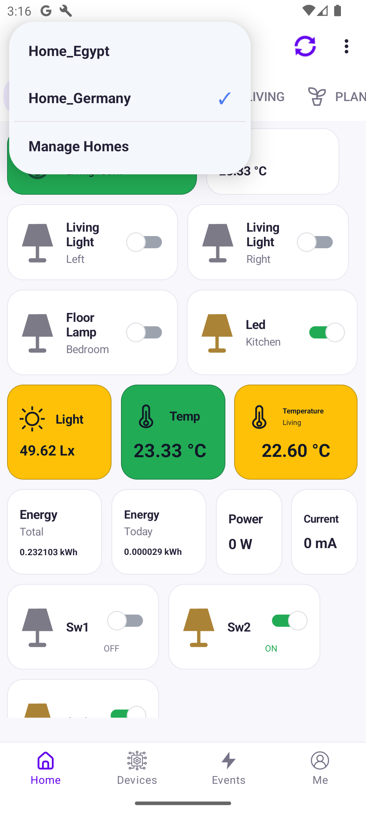
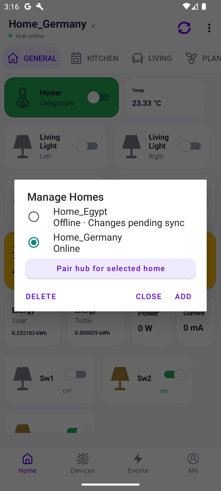
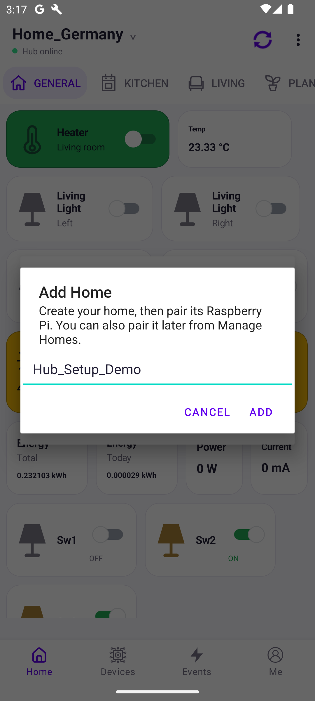
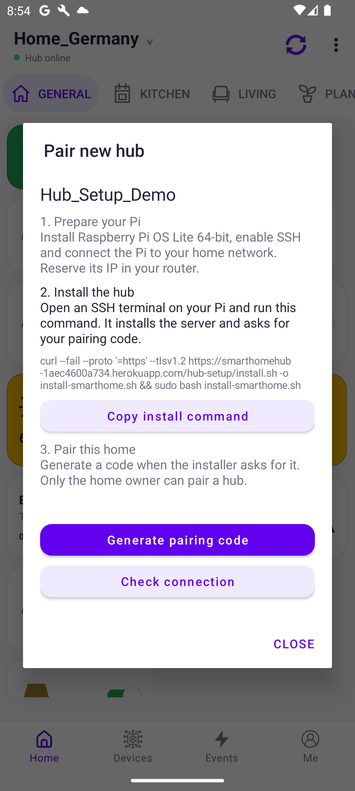
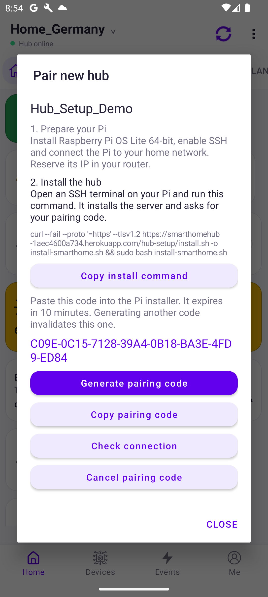
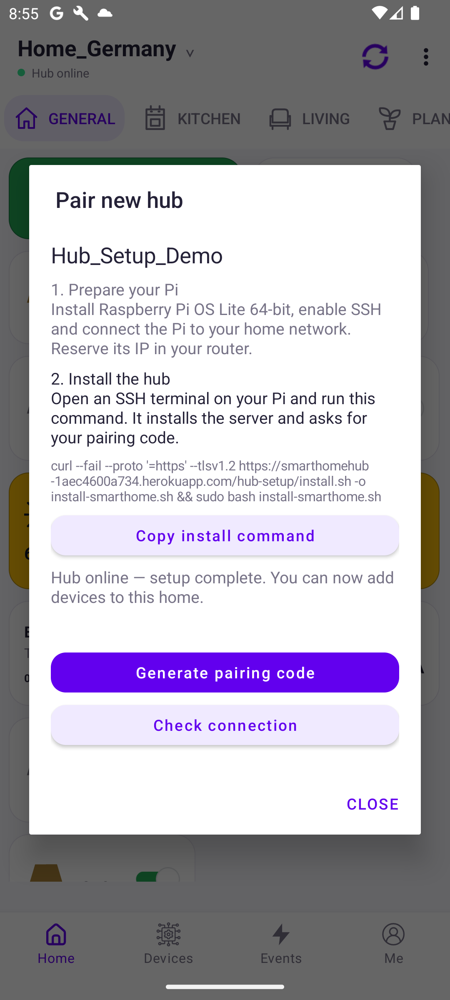

# Add a new home and pair a Raspberry Pi

Updated: 27 October 2026

The app's **Pair new hub** wizard creates a separate hub identity for a new home. You do not need to edit Heroku environment variables or copy a permanent hub token manually.

## 1. Prepare the Raspberry Pi

For core home automation, a Raspberry Pi 5 with 4 GB RAM is a practical choice. Choose 8 GB if you plan to expand local voice processing or camera services. Use the official suitable power supply, cooling, and a reliable microSD card or SSD. Ethernet is preferable where available.

Install **Raspberry Pi OS Lite (64-bit)** with Raspberry Pi Imager. In Imager, configure a hostname, username and password, SSH, Wi-Fi if needed, and your country/time zone. Boot the Pi and reserve its IP address in your router so ESP devices can reliably reach it.

Official instructions: [Raspberry Pi getting started](https://www.raspberrypi.com/documentation/computers/getting-started.html).

From your computer, open an SSH session:

```sh
ssh YOUR_USERNAME@YOUR_PI_IP
```

The installer supports ARM64. This setup does not install the separate voice stack.

## 2. Create the home in the app

Open **Home**, tap the current home name, and choose **Manage Homes**.



Tap **Add**.



Enter a unique home name, using letters, numbers, underscores or hyphens, then confirm. The pairing wizard opens automatically after the home is created.



If you close the wizard, reopen it through **Manage Homes → select the home → Pair hub for selected home**. Pairing requires the home's owner account.

## 3. Install the hub software

The wizard shows the setup steps and a copyable installation command.



Paste the command into the **Pi's SSH terminal**, not directly into your computer's shell:

```sh
curl --fail --proto '=https' --tlsv1.2 https://smarthomehub-1aec4600a734.herokuapp.com/hub-setup/install.sh -o install-smarthome.sh && sudo bash install-smarthome.sh
```

The installer downloads dependencies and creates a dedicated service account. Wait until it asks for a pairing code before generating the code, so dependency installation does not consume its validity period.

Do not run this over an existing manually installed home hub. The installer refuses to replace a service using a different installation directory.

## 4. Pair the Pi

Tap **Generate pairing code** in the app. Copy the code and paste it into the installer's prompt, then press Enter. The terminal hides the code while you type or paste.



Codes expire after 10 minutes. Generate a fresh code if necessary. The code shown here belongs to a deleted demonstration home and cannot be used.

The Pi generates and stores its own permanent credential. The app does not receive that credential. A code cannot be used to register a second Pi after it has been claimed.

If the network fails during pairing, rerun the installer on the same Pi. Its pending identity is retained so a retry can recover from a lost response.

## 5. Confirm the connection

Keep the wizard open or tap **Check connection**. When it displays **Hub online — setup complete**, close it and select your new home.



These are real app screenshots. The successful connection above used a simulated hub against the deployed server to verify pairing and configuration delivery; it was not a fresh Raspberry Pi installation.

## 6. Add devices

In **Devices**, add a SmartSnap device and optionally select a device template to create its variables. Record the assigned device ID. Configure each ESP firmware for the new home name, its assigned ID, Wi-Fi credentials, and this Pi's local server address/port as required by the firmware project.

Smart Life plugs and cameras require their own setup in the app after the hub is online. Existing devices from another home are not automatically moved.

## Existing homes and replacement hubs

A home already bound to a hub cannot be paired again with this wizard, even when that hub is offline. This protects its existing identity. Replacement of an existing hub is a separate operation and is not implemented by this wizard. In particular, do not use this procedure to overwrite the current Germany or Egypt hub installation.

## Health checks and troubleshooting

Run these commands on the Pi:

```sh
sudo systemctl status smarthome-local --no-pager
sudo journalctl -u smarthome-local -n 100 --no-pager
curl http://127.0.0.1:3000/health
```

- **Code expired:** generate a new code and retry on the same Pi.
- **Already registered:** the home already has a hub identity; do not create another identity for it.
- **Installation download failed:** check internet/DNS access, then rerun the installer. An existing credential is preserved.
- **Hub stays offline:** inspect service logs and verify the Pi can reach the gateway over HTTPS. You do not need router port forwarding.
- **Wrong architecture:** reinstall Raspberry Pi OS Lite 64-bit; this installer requires ARM64.

After setup, reboot the Pi and verify that the service starts and the app reports it online again.

## Files and backups

- Software: `/opt/smarthome/current`
- Node runtime: `/opt/smarthome/runtime`
- Data: `/var/lib/smarthome`
- Private service configuration: `/etc/smarthome/hub.env`
- Service: `smarthome-local.service`

Create a consistent SQLite backup using a new destination filename:

```sh
sudo -u smarthome env DATA_FILE=/var/lib/smarthome/smarthome.sqlite /opt/smarthome/runtime/bin/node /opt/smarthome/current/scripts/backup.js /var/lib/smarthome/manual-backup.sqlite
```

Also securely back up the private configuration and any plug/camera configuration files for disaster recovery. Do not publish these files or include their contents in screenshots.

## Verification completed

The deployed server passed 103 automated tests, and the pairing installer helper passed four recovery/identity tests. A live test verified new-home pairing, same-identity retries, rejection of a second identity, authenticated API access, configuration delivery, and the app's success screen. The temporary test home was removed afterward.

A complete installation on a fresh ARM64 Raspberry Pi still needs hardware verification. The screenshots do not imply that hardware check has already been performed.
